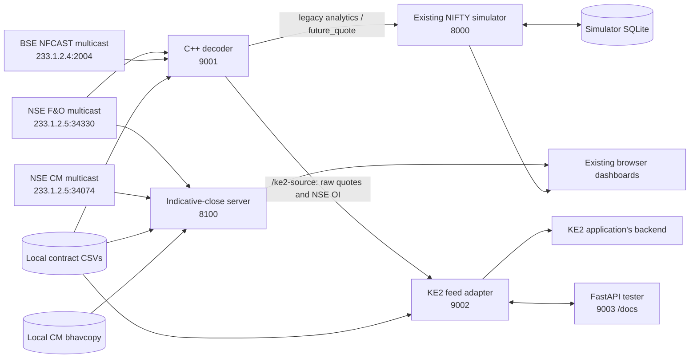
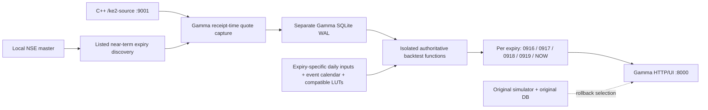

# High-level design: NSE, SENSEX, KE2 and indicative-close system

Design baseline: 19 October 2026, Asia/Kolkata.
Status: implemented architecture with explicitly listed validation gaps.
Owner/account: hritzs. Workspace: nse-fo-low-latency-decoder.

This document describes the checked-in/workspace source at backup time.
It does not claim that every available source module is deployed, that a
listening port proves market-data correctness, or that proposed KE2 v1
features have already been implemented. The backup manifest records the
exact source hashes defining this baseline.

## 1. Purpose and boundaries

The system receives exchange multicast, resolves instruments from existing
local masters, decodes market data, and serves independent consumers:

1. Existing NIFTY minute-straddle simulation via the legacy C++ WebSocket.
2. KE2 consumers needing market-data-only monthly subscriptions for stock
   futures/options and indices, including NIFTY and SENSEX.
3. A standalone indicative-close dashboard receiving NSE F&O and CM streams.
4. An optional FastAPI/Swagger tester for the KE2 WebSocket protocol.

Existing trading/hedging/PnL/risk/replay semantics were preserved during KE2
implementation. The feed adapter and tester do not place orders. The
existing simulator maintains simulated positions and persistence independently.

Cash equities displayed by the indicative service are not automatically
exported by KE2. KE2 stock support means NSE stock FUTSTK and OPTSTK.

## 2. Architectural context



The indicative service joins NSE multicast independently. It is not a
downstream consumer of the KE2 adapter, and it is not the BSE input source.
Failure or restart of the tester/adapter does not require an indicative restart.

## 3. Component ownership

| Component | Implementation | Responsibility | Excluded responsibility |
| --- | --- | --- | --- |
| Core decoder | C++20, src/main.cpp and decoder modules | Multicast, token identity, decoding, legacy analytics, isolated raw topic | KE2 client lifecycle and external reference ingestion |
| Contract loader | src/contract_loader.cpp | CSV lookup maps and existing EOD helpers | Authoritative master generation/download |
| Analytics | src/analytics_engine.cpp and math modules | Existing futures/parity/IV/Greeks outputs | Preserving raw LTP semantics for KE2 |
| Legacy WS server | src/ws_server.cpp, uWebSockets | Legacy topic and new separate raw route | KE2 contract selection |
| KE2 adapter | ke2_feed_server.py, asyncio/websockets | Master metadata, per-client selection, quotes, snapshots and recovery | Strategy, orders, invented market/reference data |
| Existing simulator | simulation_server_2.py + frontend | NIFTY simulation lanes, views, SQLite state | SENSEX strategy/UI or KE2 transport service |
| Indicative server | indicative_close_server/server.cpp | NSE futures, index/CM values, indicative-close HTTP dashboard | BSE KE2 quotes or simulator strategy |
| API tester | ke2_test_api.py, FastAPI | HTTP/Swagger client for actual KE2 operations | A replacement exchange feed or persistent production API |
| Launcher | start_system.sh | Preflight, start missing/owned services, logs, child cleanup | Build/install, master refresh, arbitrary process termination |
| Backup tooling | scripts/backup_system.py | Source, private runtime snapshots, manifests and restore inventory | Uploading licenses/credentials or restarting live services |

## 4. Interfaces and deployment ports

| Interface | Port/path | Default role |
| --- | --- | --- |
| C++ legacy WS | 9001 / | Existing analytics/future messages |
| C++ raw WS | 9001 /ke2-source | Internal raw market_quote/market_oi events |
| KE2 WS | 9002 / | New client protocol |
| Simulator HTTP | 8000 / and /api/* | Existing UI and simulated-run control |
| Tester HTTP/SSE | 9003 /docs, /sessions/* | Optional interactive tester |
| Indicative HTTP | 8100 /, /health, /api/data | Separate dashboard |
| NSE multicast | UDP 34330, group 233.1.2.5 | Core decoder and indicative F&O input |
| BSE multicast | UDP 2004, group 233.1.2.4 | Core decoder BSE/SENSEX input |
| NSE CM multicast | UDP 34074, group 233.1.2.5 | Indicative CM input |

The core WS and indicative HTTP source bind to 0.0.0.0. KE2 and tester launch
on 127.0.0.1 by default. The simulator supports configurable bind/port; the
one-command launcher defaults to localhost, but an independently launched
existing simulator may bind to all interfaces.

Multicast reachability depends on the feed-facing host/WSL network and selected
interface. Successful membership or a listening TCP port is not data validation.

## 5. Raw and derived market-data separation

The original legacy analytics path remains for current clients. Its price
handling can use midpoint/fallback logic and computed Greeks. KE2 receives
raw decoded LTP/bid/ask before analytics gates, on a separate WS topic.

This avoids requiring IV/underlying initialization before a KE2 option quote
can be published and avoids calling a bid/ask midpoint the last traded price.
Serialization is skipped when the raw topic has no connected consumers.

NSE OI events are decoded separately and merged by instrument in the adapter.
There is no guarantee that OI and price share an exchange timestamp.
BSE OI and undeclared quantities are not synthesized.

## 6. Contract identity, discovery and expiry policies

- NSE identity: the market Token column in shared/GreekTokens.csv.
- BSE identity: xx.Token under the existing loader assumption.
- Main decoder has separate NSE and BSE token maps.
- Adapter fails on conflicting global instrument_id values.
- Master is loaded once per process startup, not continuously.
- BSE FUTURE rows may have blank OpType; the adapter handles that encoding.
- Stock F&O uses FO_STK; known indices use FO_IDX.
- KE2 request expiry is an explicit cycle chosen by the client.
- Existing simulator discovers CURRENT/NEXT from received legacy data.
  Its auto NEXT calculation is Tuesday-based, without a holiday calendar.
- A weekly simulator cycle and monthly KE2 cycle do not override one another.
  Separate KE2 connections are required for different requested expiry cycles.

The authoritative export is the share-root GreekTokens.csv, imported through
scripts/refresh_market_inputs.ps1 and scripts/refresh_master.py. Checksum and
coverage validation precede atomic installation, with a prior-master rollback
copy. The 19 October import contains six near-term NIFTY expiries. One source
PAGEIND token written as scientific notation is explicitly excluded by both
loaders rather than guessed. The external publisher owns exchange-master
generation; this repository owns repeatable validated import and provenance.

## 7. Supported KE2 subset

| Capability | Current availability |
| --- | --- |
| Stock/index futures and options | Local master and decoded quotes |
| Subscribe/unsubscribe, extra held strikes, window recentering | Implemented |
| Instrument metadata | IDs, exchange, underlying, expiry, type, strike, CE/PE |
| LTP / bid / ask | Raw decoded rupee values |
| OI | Decoded NSE values; units still require independent verification |
| Snapshot / reconnect / heartbeat | Implemented with documented cache semantics |
| Lot size / tick size | Null; absent in current integration |
| Volume / LTQ / book quantities | Null in current integration |
| Exchange and trade timestamps | Null; local decode timestamp provided separately |
| Minute bars / EOD / reference_daily | Unsupported |
| Ban list / results / holidays / session calendar | Unsupported |
| KE2 feed Greeks / synthetic index future instruments | Not exposed |

The application developer can build transport and UI against this subset.
Full original KE2 strategy functionality remains dependent on missing metadata,
reference inputs and verified time/quantity semantics. The original JSON spec
is retained as a requirement, not relabelled as fully delivered.

## 8. Indicative-close service

The standalone C++17 service has three primary state families:

- Nearest non-expired NSE F&O future per underlying.
- Index live and indicative values where decoded.
- CM equity LTP, best bid/ask, OHLC/closing and indicative-close fields.

It uses shared/GreekTokens.csv to form the F&O universe and
shared/cm_bhavcopy/current.csv for CM token-to-symbol mapping. The CM loader
expects FinInstrmId, TckrSymb and SctySrs columns and uses EQ rows.

Its HTTP JSON includes futures, indices, cm_equities and diagnostics, with
availability flags controlling null output. The dashboard does not create a
new authoritative daily-reference feed for KE2.

start_indicative_server.sh is an operational maintenance script: it locates
bhavcopy on a Windows network share, copies local reference data, compiles,
and may terminate/restart the 8100 process. The new stack launcher runs an
already built indicative binary on a free port without invoking that updater.
An occupied 8100 is always left alone.

## 9. State and persistence boundaries

| State | Owner | Durability / recovery |
| --- | --- | --- |
| Token/master maps | C++ / adapter | Reload local CSVs at startup |
| Decoder packet queue | C++ | Memory only, bounded |
| Legacy quote/analytics caches | C++ | Existing partial snapshot behavior |
| KE2 quotes/OI | Adapter | Memory only; cleared on source reconnect |
| KE2 client sessions | Adapter | Memory, one hour after disconnect, lost on restart |
| Tester sessions/history | FastAPI | Memory, max 16 sessions, last 50 messages |
| Simulator runs/config/minute history | SQLite | Existing persistence and restore paths |
| Indicative data/diagnostics | Indicative server | In-memory; local files bootstrap symbols/universe |
| Source/data backup | Versioned offline archive | SHA-256 manifest and restore procedure |
| Cloud source snapshot | New private GitHub repository | Sanitized current source, Git LFS for large CSVs |

Database backups use SQLite's backup API rather than copying live DB/WAL files.
An online DB backup is transaction-consistent per database; it is not an atomic
point-in-time snapshot across every service, file and database.

## 10. Concurrency and capacity posture

Core: dedicated NSE/BSE receiver threads feed a bounded queue of 2,000 packets;
worker count follows hardware_concurrency. Workers dequeue FIFO. Parallel
processing can still complete out of order. Queue overflow drops the oldest
queued packet and diagnostics record loss. This is not lossless capture.

Legacy/WS: publication is deferred onto the uWebSockets event loop.
Raw connections use a 1 MiB socket backpressure limit and close on overflow.
The deferred event queue is not a proven bounded exchange-wide lossless queue.

Adapter: asyncio source reader, per-client handler, one-second dirty-instrument
conflation and five-second heartbeats. Healthy requires every selected quote
within ten seconds, so quiet instruments can yield DEGRADED.

Tester: one worker, independent upstream socket per test session, serialized
commands per socket, bounded history and response queue, timeout handling.
It is an inspection tool, not the scalability target for production clients.

No throughput, latency, exchange completeness, RTO or RPO SLA has been measured
and accepted. Fixture tests do not establish these operational guarantees.

## 11. Security and side-effect model

- No new order/execution endpoints were introduced.
- Existing legacy configuration/override endpoints remain a distinct interface.
- New KE2 and tester default to localhost; authenticated remote exposure or
  tunnelling is a separate deployment concern.
- Simulator POST endpoints do mutate simulated-run state and SQLite data.
- Tester DELETE closes only its own upstream connection.
- Reuse-existing launcher mode checks occupied ports, not service identity.
- Backup cloud payload excludes environments, runtime DBs, licenses, credentials,
  original Git history and generated artifacts.
- Private offline runtime/history artifacts remain local and permission-restricted.

## 12. Deployment and operation

Build to build-ke2; do not overwrite the existing build/nse_decoder.
Install API dependencies in .venv-ke2-api separately from the feed environment.

Manual activation:

```bash
bash start_system.sh --restart --gamma-weekly --with-api --lan
```

This command replaces positively identified project listeners and starts
the corrected decoder, adapter, Gamma, indicative and API tester. Unknown
listeners abort before signals. --lan exposes only the KE2 feed. Input refresh
is explicit through --refresh-inputs; it does not invoke the indicative
maintenance script. Ctrl+C cleans up newly owned child processes.

See ../../KE2_STARTUP_AND_API.md and ../../KE2_FASTAPI_TESTER.md for precise
commands, health interpretation, test requests, shutdown and rollback.

## 13. Known risks and decisions still open

| ID | Finding | Consequence / required follow-up |
| --- | --- | --- |
| R01 | Master refresh implemented | Verified share export and atomic import restore actual weekly coverage; refresh remains an operator action |
| R02 | Layout discrepancy corrected | Both match NNF 9.48 layouts; mixed raw/LZO and two-record tests pass; full live conformance is not claimed |
| R03 | BSE xx.Token wire identity not live-certified | Fixture routing is not proof of current BSE token matches |
| R04 | Exchange/trade timestamps absent | No valid exchange-time bars or exchange stale-price guarantee |
| R05 | OI units not independently certified | Avoid unverified lots/quantity conversions or threshold assumptions |
| R06 | Overflow and parallel processing | Loss/out-of-order completion possible; load-test and design sequencing if required |
| R07 | Generic legacy quote recovery is incomplete | KE2 uses its own raw store/recovery; legacy behavior is not upgraded |
| R08 | Legacy holiday arithmetic retained | Gamma uses actual listed dates; the rollback simulator retains Tuesday-based NEXT estimation |
| R09 | Existing indicative local-date handling depends on process environment | Calendar/session interpretation requires operational timezone verification |
| R10 | In-memory API/KE2 sessions | Rebuild subscriptions after process restart; no durable replay |
| R11 | Public GitHub publication completed | hritzs/nse-sensex-ke2-system-backup; receipts verify commit and visibility; runtime/licenses stay offline |
| R12 | Package/native dependencies outside source backup | Preserve version inventory and rebuild instructions; binaries alone are not a portable environment |

## 14. Verification baseline and document map

Implemented tests cover raw NSE/BSE packet fixtures, truncation and token
isolation, stock/SENSEX transport through the real C++ WS, KE2 operations,
FastAPI error/recovery flows and launcher ownership cleanup. They are not
live exchange conformance tests.

- LLD.md: classes, fields, algorithms, states, interfaces and runtime behavior.
- ADR.md: design choices and tradeoffs.
- ../../KE2_DEVELOPER_API.md and ../../KE2_API_EXAMPLES.json: client contract.
- ../../KE2_FASTAPI_TESTER.md: Swagger workflow.
- ../backup/BACKUP_RESTORE.md: artifact inventory, verification and recovery.
- Backup MANIFEST.json: exact source hashes, captured runtime and GitHub status.

## GammaShort extension and explicit restart (19 October 2026)

The user subsequently authorized a new simulator based on
GammaShort_Backtest_Final.py, with five independent lanes for every weekly
expiry and fixed-time filter bypass. This is an opt-in replacement process at
8000, implemented separately from the retained legacy simulator and database.



Reference data is bound to date AND expiry. Current-week daily inputs are never
reused for later expiries. As explicitly selected, missing daily references
record REFERENCE_UNAVAILABLE while full fixed-trade mathematics continue.
Missing events block sizing as WAITING_INPUTS. The exact five CW tables are
present and match their 52,920-row shapes and expected YES counts. Old Custom
tables remain separate. No market inputs or replacement LUTs are invented.

The adapter retains the backtest's numerical functions, event sizing and costs,
while disabling its separate production CW/NW selection. It removes historical
backward fill and uses locally observed quotes. Call-put parity provides an
expiry-specific synthetic underlying. Calendar DTE ends at expiry 15:30 IST.
Exchange timestamps and trade markers remain unavailable, so live tick-backtest
parity is unverified. Forward fills and current-tail PnL are provisional until
future observations exist; no exit tick is invented after the feed stops.

Instrument masters do not identify weekly versus monthly contracts.
Default discovery uses listed unexpired NIFTY options within 42 days; an
explicit verified allowlist is supported. Current near-term coverage is loaded
from the authoritative refreshed master rather than inferred weekday dates.

`start_system.sh --restart --gamma-weekly --with-api` validates dependencies
and required Gamma references before stopping anything. A helper identifies
every selected listener from /proc, requiring the exact project binary/script
and process start time. Unknown listeners abort the stop plan. Explicit restart
includes indicative 8100 and optional API 9003; no broad process-name kill or
bhavcopy maintenance launcher is used.

Source and reference hashes bind Gamma configuration per trade date. New-day
reference updates can reuse the DB; same-day changes require a new DB path. Existing simulator state is untouched. The offline backup
includes both implementations, both sets of data if present, the authoritative
backtest, indicative server, model inputs, startup scripts, tests and these
design documents. GitHub receives only sanitized current source.

See [Gamma operation/API](../../GAMMA_WEEKLY_SIMULATOR.md) for precise timing,
response fields, deployment limitations and rollback.

## Current implementation references

See [Gamma operation/API](../../GAMMA_WEEKLY_SIMULATOR.md) for inputs, all 30
lanes, full calculations, missing-reference behavior, freshness and rollback.
Windows Git is installed and VS Code git.path is configured. Public source
and offline runtime/history have separate manifests and upload receipts.

## Complete stack entry command

Run bash run_all.sh from the project root in WSL. This selects verified
restart, Gamma weekly simulator, indicative-close, KE2, C++ decoder and
FastAPI tester with LAN bindings (--lan-all). Legacy start_system.sh
selection flags remain supported, including the feed-only --lan mode.
The restart lock covers service replacement/startup and is released before
the monitor loop, allowing another invocation to replace the stack.
The separate launcher lock protects ownership until cleanup completes.
Local and LAN service URLs and HTTP route lists are printed and saved in
logs/system-<timestamp>-<pid>/endpoints.txt. KE2_PUBLIC_HOST overrides the
address printed by automatic detection. See KE2_STARTUP_AND_API.md and
docs/verification/run_all_repeat_restart.json.

## Token-master freshness update (28 October 2026)

The complete launcher refreshes both authoritative NSE and BSE masters on
every normal invocation before the coordinated service restart. The token-only
refresh excludes model references and LUTs. --check is read-only and
--no-refresh-masters permits deliberate offline startup. Consumers retain
immutable startup maps until the coordinated restart; no runtime C++ map
replacement is attempted. See docs/verification/EXPIRY_REFRESH_20261028.md.
