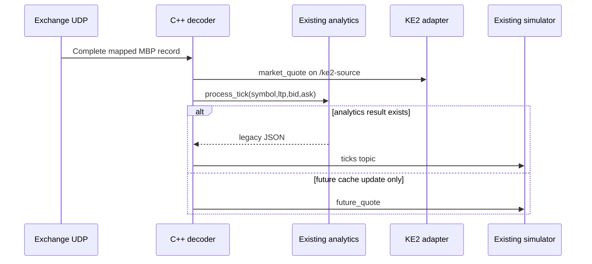
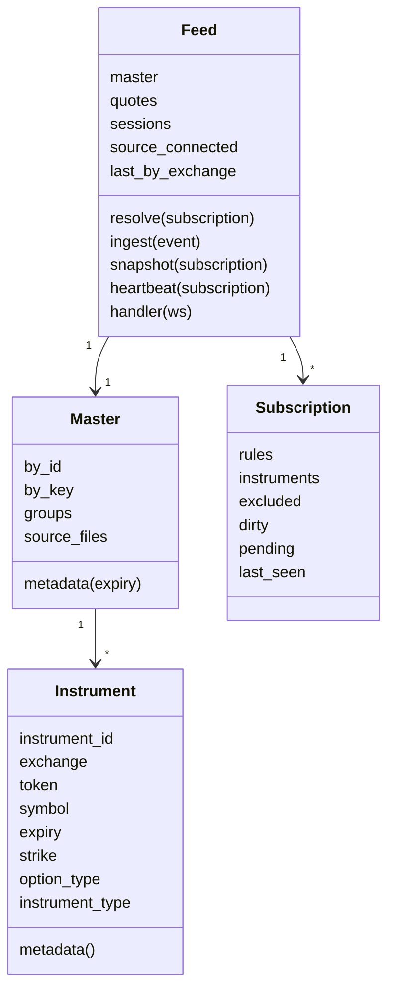

# Low-level design: implemented system

Updated: 19 October 2026. This document is tied to the hashes in the versioned
backup manifest. It complements HLD.md and the client API documentation; it
does not redefine or change strategy behavior.

## 1. Build and source map

| Module | Primary files | Main entry / dependency |
| --- | --- | --- |
| Main decoder | src/main.cpp, include/config.h | C++20 nse_decoder target |
| Contracts | src/contract_loader.cpp, include/contract_loader.h | g_contractLoader |
| Packet dispatch | src/decoder.cpp | process_packet(exchange, bytes, length) |
| NSE MBP | src/parser_7208.cpp | parse_7208(bytes, length) |
| Raw emission | src/market_feed.cpp, include/market_feed.h | publish_market_quote / publish_market_oi |
| WebSocket | src/ws_server.cpp, include/ws_server.h | start_ws_server(port) |
| Analytics | src/analytics_engine.cpp, symbol_parser.cpp, bs.cpp, iv.cpp, greeks.cpp | Analytics::process_tick |
| Expiry helpers | src/expiry_engine.cpp, contract_loader.cpp | Existing date parsing and nearest helpers |
| KE2 | ke2_feed_server.py | run(args), Feed |
| Tester | ke2_test_api.py | create_app(), app |
| Simulator | simulation_server_2.py, frontend/* | main(), SimulationHandler |
| Indicative | indicative_close_server/server.cpp | standalone C++17 main |
| Lifecycle | start_system.sh | foreground shell owning only started child PIDs |
| Backup | scripts/backup_system.py | versioned offline artifacts and manifests |

CMake links uWebSockets/uSockets, pthread, OpenSSL, zlib, lzo2, hiredis, zmq
and math. DISABLE_KDB is defined. Redis is disabled as a live startup
dependency in main. ZeroMQ feed_handler is a separate optional target, not an
active hop in the documented direct multicast chain. Repository Docker/KDB/
frontend/LLM definitions are optional or historical deployments.

## 2. Contract data structures and normalization

### 2.1 C++ Contract

Fields: xxToken:uint32, marketToken:uint32, exchange:NSE|BSE,
opType:CALL|PUT|FUTURE, symbol, expiry, expiryShort, strike:double, opStr,
dte:double, expiryDate:time_t, eodPrice:double.

ContractLoader owns maps for marketToken, xxToken, symbol and symbol|expiry.
NSE CSV columns are interpreted positionally: xx.Token, Exchange, Type,
Symbol, Expiry, Strike, OpType, Token. Accepted option encodings include
CE/PE and future encodings XX/FUT/blank. BSE uses xx.Token as marketToken
because its Token field uses strings such as IO/IF.

Main builds separate immutable-at-runtime TOKEN_MAP (NSE) and BSE_TOKEN_MAP.
Each value is a pair of pipe symbol and Exchange:

```text
UNDERLYING|DD-MMM-YY|STRIKE|CE
UNDERLYING|DD-MMM-YY|STRIKE|PE
UNDERLYING|DD-MMM-YY|0|FUT
```

The adapter uses ISO expiry dates independently of legacy formatting.
Unknown numeric IDs are skipped by decoding; no metadata is guessed.

### 2.2 Python Instrument / Master

Instrument is a frozen dataclass:

```text
instrument_id:int
exchange:str
token:int
symbol:str
expiry:str  # YYYY-MM-DD
strike:float|null
option_type:CE|PE|null
instrument_type:FUTSTK|OPTSTK|FUTIDX|OPTIDX
```

Master.by_id maps global integer IDs. Master.by_key maps (exchange,token).
Master.groups maps (symbol,expiry) to instruments. Conflicting by_id entries
raise ValueError at startup. Identical repeated records collapse by ID.

Blank OpType with Type FUTURE/FUTIDX/FUTSTK is normalized to FUT. Known index
symbols determine IDX vs STK; other symbols map to stock F&O. Metadata adds
lot_size:null, tick_size:null and unavailable_fields. Master.source_files
records relative file paths and actual file modification times.

Date formats accepted by the adapter: DD-MMM-YY, DD-MMM-YYYY, YYYY-MM-DD.
Invalid rows are skipped. Master loads all available dates, including expired
ones; lookup is not an authoritative current-trading-universe filter.

## 3. Core ingress, queue and dispatch

### 3.1 Receive lifecycle

main loads NSE/BSE masters, builds maps, starts WS on 9001, starts
hardware_concurrency workers and starts NSE/BSE multicast listener threads.
BSE_LOCAL_IP is read from environment with a 0.0.0.0 fallback.

multicast_listener:
1. Create UDP socket, set reuse, receive timeout and bind configured port.
2. Join configured multicast group using the chosen local interface.
3. Receive into a 65,536-byte buffer.
4. Create QueuedPacket {exchange,data,rx_ns} using a monotonic receive timestamp.
5. Under QUEUE_MTX, drop oldest if MAX_PACKET_QUEUE=2000 is reached; append packet.
6. Notify worker condition variable.

Workers wait for running=false or a nonempty queue. Each takes the front
packet under lock, releases the lock and calls process_packet. Queue and
processing latency metrics are maintained. Packet completion is not sequenced
across workers; dequeue FIFO does not guarantee ordered completion.

SIGINT sets the running flag false and notifies workers. Listener receive
timeouts allow shutdown checks. Main joins both listeners and worker threads.
The launcher signals owned decoder processes with SIGINT for this path.

### 3.2 NSE framing and MBP (NNF 9.48)

The main and indicative parsers use transaction-specific layouts. The official
March 2026 tables specify 7208: record 214, LTP +12, bid +60, ask +120;
17208: record 258, LTP +16, bid +68, ask +148. MBP is five bid levels then
five ask levels, with 12-byte legacy or 16-byte enhanced entries. Prices are
divided by 100. Batch count is at header +40; record start is +42. Both records
are validated before any batch publication; truncated batches publish nothing.

NSE sequential packing accepts mixed compressed and uncompressed messages.
CompressionLen=0 is a valid raw message, not a drop. Eight prefix bytes precede
the 40-byte BCAST header; raw length comes from MessageLength at header +38.
Compressed messages use bounded lzo1z_decompress_safe output.

Decoder counters are atomic. DECODE STATS separates datagrams, parsed messages,
rejected units, uncompressed messages, LZO errors and framing errors. Parsed
messages can exceed datagrams because one datagram contains multiple messages.
Queue-overflow drops are a separate ingress metric. A shared report mutex
serializes health/log blocks and protects the once-per-second report state.
Tests cover both layouts with two records, mixed raw/LZO framing and every
truncated fixture prefix. Exchange-wide lossless delivery is not asserted.

Primary protocol: https://nsearchives.nseindia.com/web/mediaattachment/2026-03/TP_FO_Trimmed_NNF_PROTOCOL_9.48_20260313174413.pdf

### 3.3 BSE NFCAST

BseParser wraps a buffer with a checked cursor. Primitive reads/skips throw
out_of_range on insufficient bytes. process_packet catches that exception
for BSE and increments dropped diagnostics; incomplete book records do not
publish a manufactured zero/partial quote.

Handled messages:
- 2011/2012: existing spot/index path updates analytics underlying cache.
- 2020: 32-bit market token.
- 2021: extended token; values exceeding uint32 are rejected rather than aliased.

The existing record parser skips declared headers/stats, reads LTP and
decompresses best bid/ask relative values. Escape/sentinel interpretation is
retained from existing source. BSE_TOKEN_MAP performs exchange-specific lookup.

After a complete mapped record:
1. Emit raw BSE quote, independently of analytics readiness.
2. Pass price data to existing Analytics::process_tick.
3. Publish returned legacy analytics, if any.
4. For futures with an empty analytics result, publish legacy future_quote.

BSE quote identity/record format is fixture-tested, not live-certified.
Quantities and BSE OI are not exported merely because skipped fields exist.

## 4. Raw publication and legacy isolation

publish_market_quote emits:

```text
type:market_quote
exchange:NSE|BSE
token:uint32
received_ms:local system-clock milliseconds at raw emission
exchange_ts:null
last_trade_ts:null
ltp/bid/ask:number|null
ltq/bid_qty/ask_qty:uint64|null
```

publish_market_oi emits type:market_oi, exchange, token, oi:uint64 and
received_ms. Nonfinite/negative price values are serialized as null.
No exchange timestamp is invented. received_ms is not the earlier monotonic
UDP timestamp and is not an exchange-time ordering key.

market_source_active checks an atomic source-client counter before
serialization. broadcast_market_source defers publication on the uWS loop
to market_source. /ke2-source sockets subscribe only to that topic.

Legacy sockets on the wildcard route subscribe to ticks. Legacy messages
are not replaced with KE2 batches. Existing configuration/override/HTTP EOD
helpers remain in ws_server.cpp and are outside the new KE2 protocol.

Raw sockets close on a 1 MiB backpressure limit. Raw cache/snapshot management
is in the Python adapter; the C++ raw route does not replay the legacy cache.

### Sequence: independent consumer delivery



## 5. Existing analytics and expiry behavior

Analytics maintains futures by underlying/expiry, underlying fallbacks,
option LTP/bid/ask caches, observed strikes, parity synthetic futures,
IV surfaces, option statistics, overrides and EOD stores under its existing
locking scheme.

process_tick parses pipe or compact symbols; futures update caches and
return no analytics payload. Options require usable price and a cascading
underlying reference before IV/Greeks output. Legacy price uses midpoint
when a usable two-sided book exists; raw KE2 output bypasses this choice.

C++ expiry/time calculation and legacy analytics use 15:30 in relevant paths.
The Python simulator uses its existing 15:40 session close. These conventions
were preserved, not silently reconciled.

ExpiryEngine.is_weekly uses string length and nearest returns the first
supplied entry; these helpers do not create missing weekly contracts.
ContractLoader date parsing is the active path for relevant analytics dates.
Existing parsing/heuristic limitations remain design debt.

## 6. KE2 adapter design

### 6.1 State



quotes is keyed by instrument_id. Stored fields include raw prices,
quantities if supplied, NSE OI, received_ts and a private monotonic quote
freshness timestamp. Private freshness fields are not returned as market data.

Subscription.rules stores requested cycle and underlying selection.
instruments is the resolved set. excluded pins unsubscriptions across
recentering. dirty tracks IDs pending the next streaming batch.
pending lists missing future contract/quote dependencies.
last_seen is infinity while active, monotonic disconnect time otherwise.

### 6.2 Subscribe validation and resolution

Validation is completed before replacing the existing rules:
- Expiry parses; 1..100 underlying objects.
- Known symbol/expiry group exists.
- FO_IDX for known indices, FO_STK otherwise.
- future is a Boolean.
- options mode is around_future, CE/PE types explicit, side count 0..1000.
- Optional step is a finite positive number.
- extra_strikes are finite nonnegative listed strikes and require options.

Resolution:
1. Add exact-expiry futures if requested.
2. Record future_contract_unavailable if required future metadata is absent.
3. Obtain the latest observed positive LTP of an exact-expiry future.
4. Without that quote, record future_quote_unavailable; do not invent an anchor.
5. Sort listed strikes, optionally filter the selection grid by step.
6. Choose nearest strike to future; distance ties select the lower strike.
7. Take up to N each side plus centre; include explicit extra_strikes.
8. Add selected CE/PE IDs and subtract excluded IDs.

A new subscribe replaces the whole connection cycle and resets exclusions.
A future quote triggers resolution again. New resolved IDs enter dirty.
Window removals have no separate removal event; a full snapshot is the
authoritative membership view.

### 6.3 Ingest and output

The source task reconnects every two seconds after failure. On successful
source reconnect it clears quote/OI cache and exchange activity, resolves
sessions and marks current IDs dirty for refreshed snapshots/updates.

Only market_quote/market_oi events for known (exchange,token) pairs are accepted.
Invalid numeric values are rejected. Local millisecond timestamps are converted
to ISO-8601 IST. NSE OI updates preserve Python integer width.

On client connect, send capabilities/session_id/master provenance.
On subscribe, send subscribed acknowledgement then quote snapshot:true.
Every second, emit dirty selected instruments as quote snapshot:false.
Each row contains the complete supported row shape, not only changed fields.
Unsupported values remain null. On disconnect, preserve session memory for
up to one hour; cleanup runs once a minute.

Heartbeats are emitted every five seconds. OK requires source connection,
nonempty resolved selection, no pending dependency and every selected quote
within ten seconds. Exchange recent-event status is not per-field certification.

### 6.4 KE2 commands

| Command | Output |
| --- | --- |
| subscribe | subscribed + full quote snapshot |
| unsubscribe | unsubscribed; excluded IDs persist until next subscribe |
| instrument_master | Chunks of <=500 records, more flag |
| snapshot | Full quote snapshot of current membership |
| resume | Full snapshot of saved inactive session; no subscribed ack |
| Other types, including eod/bar_1m/reference_daily | error:unsupported |
| Invalid input | error:invalid_request |

resume requires a known, inactive, unexpired session. A second active user of
that session is rejected. Adapter restart loses saved sessions. Snapshot
recovery does not replay missed ticks or guarantee source continuity.

Full exact wire fields: ../../KE2_DEVELOPER_API.md and
../../KE2_API_EXAMPLES.json. The spec JSON remains unchanged.

## 7. Existing simulator design and persistence

### 7.1 Model and thread ownership

MarketBook stores NIFTY option quotes, synthetic/actual futures by expiry,
receipt times, expiry selection, extrema and minute history under its lock.
It filters non-NIFTY instruments and excludes BANKNIFTY/NIFTYNXT50 confusion.

OptionQuote fields: symbol, expiry, strike, option_type, ltp, bid, ask, iv,
rx_monotonic and timestamp.

SimulationController owns CURRENT/NEXT sets of five run IDs:
0916, 0917, 0918, 0919, NOW. It restores existing state and dispatches market
snapshots to appropriate lanes. A WebSocket thread ingests legacy messages,
a processor thread advances existing logic, and ThreadingHTTPServer serves UI.

MinuteSimulation preserves entry/held-leg identity, frozen entry prices,
live marks, ATM/reference metrics, IV/Greeks, hedge target and cash,
option/future/total PnL, exit thresholds, histories, event timestamps and locks.
Key method boundaries:
- arm/_enter: lifecycle and entry initialization.
- process_snapshot: existing per-snapshot strategy path.
- _calculate_greeks/_calculate_risk/_set_tp_sl: existing calculations.
- _execute_hedge/_maybe_rebalance/_update_pnl: simulated ledger/hedging behavior.
- _record_minute/finish/restore/snapshot: persistence and exposed state.

This design documents those boundaries; no new strategy formula or external
order-execution flow is added. The exact existing source defines financial
calculations and completion/replay semantics.

### 7.2 Expiry and calendar behavior

MarketBook derives nonexpired candidates from received options/futures/
synthetic caches. Auto CURRENT chooses earliest available. Auto NEXT requires
the calculated immediately following Tuesday expiry to be present, otherwise
None. Manual mode uses the selected expiry and a later available candidate.
There is no external holiday-adjusted listing calendar.

Python trading session is 09:15..15:40 IST (385 minutes), retained from the
existing simulator. It must not be confused with unavailable KE2 exchange bars.

### 7.3 SQLite schema

| Table | Primary key | Other columns / role |
| --- | --- | --- |
| minute_runs | trade_date, run_id | status, expiry, updated_at, payload JSON; existing compatibility storage |
| minute_lane_runs | trade_date, expiry_view, run_id | status, expiry, updated_at, payload JSON |
| minute_config | key | value, updated_at |
| market_minute_history | trade_date, expiry, minute_key | timestamp, payload JSON |

Persistence methods use existing connection/locking/commit behavior.
Default DB is data/minute_simulation.db; MINUTE_SIM_DB may override it.
Docker deployment maps persistent host directories and must retain its own
DB path. Never initialize a new empty database as a substitute for restoration.

### 7.4 Existing HTTP surface

GET: /, /app.js, /styles.css, /api/health, /api/expiries,
/api/expiry-view (alias /api/expiry_view), /api/runs, /api/runs/{run_id},
/api/market-history.

POST: /api/select_expiry_view (alias /api/select_view),
/api/auto-next-expiry (alias /api/auto_next_expiry), /api/select_expiry,
/api/runs/NOW/start, /api/runs/{run_id}/clear.

Health endpoints report process/application state, not exchange-price
certification. POST endpoints mutate simulated state and are not used by
backup/architecture generation. Replay scripts remain operator-invoked;
they are backed up but not run as a backup step.

## 8. Indicative-close server: complete component design

### 8.1 Startup and threading

Standalone main:
1. Load CM symbol map from shared/cm_bhavcopy/current.csv.
2. Install existing signal handlers.
3. Build nearest nonexpired NSE future universe from shared/GreekTokens.csv.
4. Exit if future universe is empty.
5. Start http_loop, multicast_loop (F&O) and cm_multicast_loop threads.
6. Join listener threads; stop HTTP thread during shutdown.

No KE2, FastAPI, simulator or Redis dependency is required for its core path.

### 8.2 Maps and flags

FutureQuote: token, symbol, expiry, ltp/bid/ask, has_ltp/has_bid/has_ask,
updates and last_rx_ms. g_futures is token keyed.

IndexQuote: name, live_value, indicative_value, availability flags,
live/indicative update counts and display times. g_indices is name keyed.

CmQuote: token, symbol, alpha, LTP/bid/ask, closing/open/high/low/indicative
prices, availability flags for each, update count, last_rx_ms.
g_cm_quotes is token keyed. g_cm_symbol_by_token maps IDs to CM symbols.

g_monthly_future_symbols restricts relevant stock universe; g_state_mtx
protects shared state during updates/JSON construction. Packet/decompression/
transaction/update diagnostics are retained.

### 8.3 Local reference loading

CM file requires FinInstrmId, TckrSymb, SctySrs. Loader uses EQ rows and does
not pretend two-character broadcast AlphaChar is a complete stock symbol.
F&O universe uses NSE FUT/XX contracts, validates expiry sort keys and chooses
one nearest nonexpired future per underlying based on local calendar date.

The source's localtime behavior depends on its process environment. The
design baseline does not claim a new timezone patch was applied.

### 8.4 Wire decoding and the layout discrepancy

F&O input: group 233.1.2.5:34330. CM input: 233.1.2.5:34074.
The service has its own framing/decompression paths and diagnostics.

Its F&O parse_fno currently distinguishes:
| Code | Record bytes | LTP offset | MBP base | MBP item bytes | Price inside item |
| --- | --- | --- | --- | --- | --- |
| 7208 | 214 | +12 | +56 | 12 | +4 |
| 17208 | 258 | +16 | +60 | 16 | +8 |

This is different from the main decoder's single 214-byte implementation.
The architecture records both as implemented and flags reconciliation for
live protocol validation; it does not declare either certified by this audit.

The CM 7208 path uses configured 262-byte records, with indicative-close at
+258, best-bid price at +68 and best-ask price at +148, plus existing index
handling paths. Actual field availability remains per decoded packet/type.

### 8.5 HTTP API and dashboard

The standalone socket HTTP server binds 0.0.0.0:8100 and recognizes:
- GET /: embedded HTML dashboard.
- GET /health: {ok:true}; process reachability only.
- GET /api/data: make_json snapshot.
- Other requests: existing not-found behavior.

Top-level /api/data keys: ok, timestamp, futures, indices, cm_equities, diag.
- futures groups by symbol, with rows containing expiry, ltp, bid, ask, updates.
- indices rows contain name, live and indicative values.
- cm_equities contains token, symbol, alpha, ltp, bid, ask, closing_price,
  open_price, high_price, low_price, indicative_close, updates.
- diag includes UDP/decompression/transaction/CM/future update counters and
  unknown_future_tokens.

Availability flags govern nulls; the health result does not establish all
markets or indicative values are current. This API is separate from KE2's
contract and must not be treated as its EOD/reference_daily implementation.

### 8.6 Maintenance and restoration

start_indicative_server.sh finds the latest NSE CM bhavcopy on the configured
Windows UNC share, copies local current.csv, compiles the standalone binary,
and can stop/force-stop/restart the process owning 8100 after name checks.
It has data/network/process side effects and is never run by backup tooling.

Offline backup includes server.cpp and its source variants, existing binary,
CM current.csv and available CM bhavcopy files. Restoring source/reference/
binary does not require invoking the updater or contacting the old share.

## 9. FastAPI tester LLD

InputModel uses strict extra-field rejection and finite-number validation.
OptionWindow, Underlying, Subscribe and Unsubscribe provide Swagger models.
create_app owns an in-memory session registry, capped at 16 sessions,
and a registry lock. Single Uvicorn worker is required for stable session IDs.

Session owns:
- HTTP-local id and distinct upstream KE2 session ID.
- WebSocket, background reader, connected/last_error state.
- Actual capabilities, latest acknowledgement and heartbeat.
- Latest quote cache; snapshots replace membership, deltas replace rows.
- Last 50 messages as {cursor, observed_at, message}.
- command_lock and bounded response queue (256 messages) for one pending request.

open verifies KE2 capabilities. read records actual messages and notifies
the current command waiter. exchange sends one command, correlates available
request IDs, ignores unrelated heartbeat/delta messages and waits for its
reply pattern. A timeout closes the socket to avoid matching a late
uncorrelated snapshot to a later command.

reconnect closes only its own socket, opens another and resumes the old
session; short retries handle an upstream active-session disconnect race.
Application shutdown closes tester-owned connections only.

Routes and exact status handling are in ../../KE2_FASTAPI_TESTER.md:
health, capabilities, instruments, sessions CRUD, subscribe, snapshot,
unsubscribe, reconnect, raw request, cached quotes, event polling and SSE.
SSE reuses local bounded history, not a second market subscription.
The local cursor is not an exchange sequence or durable event log.

## 10. Launcher LLD

Flags: --check, --restart, --reuse-existing, --gamma-weekly, --with-api,
--no-simulator, --no-indicative, --refresh-inputs and --lan.
The original simulator remains the rollback/default selection; the completed
stack explicitly selects --gamma-weekly. KE2_HOST defaults to 127.0.0.1;
--lan binds 0.0.0.0:9002. The API tester and simulator remain localhost.

Explicit input refresh verifies source/destination SHA-256 and source stat
stability for each file, then validates and atomically installs the NSE export.
Prior master and provenance are retained. No token is inferred. PowerShell's
process-only policy override does not alter persistent Windows settings.

Dependency/master/calendar and selected-port checks precede any stop. Restart
resolves ss PIDs and validates /proc exe, cwd, argv and starttime for all
targets. Rebuilt executables marked (deleted) retain their verified project
identity. Unknown listeners abort the entire stop plan. Signals use bounded
INT/TERM/KILL and recheck identity. Indicative 8100 is included in explicit
restart; reuse leaves existing processes unmanaged.

Separate flock descriptors protect restart and owned launcher operations;
children close both before exec. Readiness means TCP listening. Startup or
managed-child failure cleans up owned children. Ctrl+C has the same bounded
cleanup. Logs are logs/system-<IST-time>-<pid>/<service>.log.
No auto-boot daemon is installed.

## 11. Backup and restore implementation contract

Source snapshots are versioned and manifest-hashed. The first GitHub payload
has sanitized initial history; later publications retain the remote main
commit as parent and push without force. Git LFS stores large market CSVs. It excludes local
credentials/license, DBs, logs, environments, build products and original
historical Git objects.

Private offline payload additionally includes consistent SQLite snapshots,
existing/native binaries, a local license if present, and a Git history bundle.
Private artifacts are never placed in the new repository. Their inclusion and
SHA-256 values are listed in MANIFEST.json and SHA256SUMS.

Restore into a NEW directory, verify checksums, rebuild dependencies/native
libraries, restore only the intended DB path, then validate services before
authorized activation. Source backups are not themselves a license grant or
a complete OS/native dependency image.

## 12. Test and acceptance boundaries

- C++ packet tests: NSE/BSE raw identity, price semantics, legacy futures,
  extended token handling and all truncated prefixes of fixtures.
- Adapter tests: validation, pending resolution, extras/recentering, raw LTP,
  OI width, snapshot/unsubscribe/resume, stock segment handling and isolation.
- Transport fixture: real C++ WS -> adapter -> client for SENSEX and stock F&O.
- API tests: Swagger/OpenAPI, capabilities/master, stock snapshots/events,
  unsupported/invalid requests, reconnect/isolation, failures and timeouts.
- Launcher tests: stand-in services plus actual optional FastAPI on temporary
  ports; Ctrl+C ownership cleanup.
- Backup verification: hashes/archive inventory and SQLite integrity checks.

Tests do not certify live protocol layout, multicast completeness, current
token mapping, latency under load, OI units, calendar accuracy or EOD coverage.
No strategy/replay script is executed as an architecture or backup test.

## Gamma all-expiry extension: implementation details

This extension supersedes only the earlier statement that the legacy simulator
is the sole simulator implementation. Its original code, CURRENT/NEXT behavior
and schema remain valid when launched without --gamma-weekly.

### Source boundaries and model loading

| Source | Responsibility |
| --- | --- |
| gamma_weekly_engine.py | AST-isolated model, reference validation, independent fixed-lane evaluation |
| gamma_weekly_server.py | Raw quote ingestion, expiry discovery, observation persistence, HTTP/UI |
| scripts/check_gamma_inputs.py | Read-only strict/non-strict reference readiness |
| scripts/restart_project_services.py | All-target identity validation and bounded signals |
| GAMMA_WEEKLY_SIMULATOR.md | Operator and developer contract |
| tests/test_gamma_weekly.py | Deterministic model, persistence, reference and two-expiry HTTP tests |
| tests/test_system_operations.py | Live-WAL backup and unknown-process restart isolation |

load_engine parses the supplied backtest and selects imports (excluding numba),
plain-name/tuple module assignments and functions. It strips njit decorators,
avoids module main/if/expressions and therefore does not execute batch work or
the author's environment-variable assignments. Numerical functions remain
authoritative. An AST transform removes historical bfill calls and the
production decide() invocation, and returns LUT_UNAVAILABLE for absent tables.
The original file is not modified.

ReferenceData loads exactly five CW tables via the author's row-count/Trade
loader. Tables remain None on failure; no false-filled substitute is supplied.
Expiry-specific normalized CSV records are validated finite/positive and unique
per (Date,Expiry). The original daily loader binds each row through its own Expiry column;
GS_DAILY_EXPIRY can explicitly bind a CSV lacking that column. Event XLSX first column or Date-header CSV
must be supplied; missing events do not silently become a non-event calendar.
Hashes cover the author source, both adapter files and every loaded input.
Changed fingerprints reject same-day model/reference edits; different trade
dates may bind new reference versions in the same database.

### Observation and lane sequence

```mermaid
sequenceDiagram
 participant C as C++ raw route
 participant G as Gamma asyncio
 participant D as Gamma SQLite
 participant E as Authoritative fixed engine
 participant H as HTTP client
 C->>G: NSE market_quote
 G->>G: Master lookup; NIFTY expiry; positive uncrossed book
 G->>G: Pair fresh CE/PE; synthetic U/bid/ask
 G->>D: Observed-second rows, nearby and held strikes
 G->>D: Read expiry/date rows (periodic worker thread)
 G->>E: Frame + that expiry inputs + five fixed requests
 E-->>G: Per-lane signal, fills, hedge/exit and normalized PnL
 G->>D: Lane results keyed by model version
 H->>G: GET /api/state
 G-->>H: Expiries, per-lane results, missing inputs and basis
 H->>G: POST /api/now with expiry
 G->>D: First next-minute request, idempotent for that day/expiry
```

Master IDs use the KE2 Master implementation. Expiry eligibility is either an
explicit listed allowlist or [today,today+42 days] option expiries. Expired and
far quarterlies are excluded by that rule, without claiming authoritative
weekly classification.

Quote keys are (expiry,strike,side). Ingestion accepts actual finite positive
LTP/bid/ask with bid<=ask. Both legs must be received within ten seconds.
The anchor minimizes abs(callLTP-putLTP). Synthetic underlying is
K+callLTP-putLTP, bid is K+callBid-putAsk and ask is K+callAsk-putBid.
No underlying tick is recorded without a newer observed option update.
The recorded window is ATM +/-150 points plus strikes already held.
Underlying quotes are not forward-filled into absent observed seconds.

DTE is (expiry15:30IST-receiptTime)/86400. The model's weekend adjustment and
clipped bucket calculation are then retained. Input DTE parity with historical
files is not asserted. IV uses quote-observation OTM updates; no trade-print
flag or exchange timestamp exists in this feed.

evaluate serializes access to its isolated module in the single calculation
worker. It sets the four fixed entries and optional next-minute NOW HHMM,
injects one expiry frame and its inputs, disables production selection, and
captures simulate_cw details. Fixed strike is retained. Entry signal is
diagnostic only. Event gross/notional scale by 1/3 while entry cost is retained,
matching the fixed comparison. Full calculations use the original model,
including 30-observed-row option and 3-observed-row futures fills.

An exit is CLOSED only after a non-EOD trigger has at least 61 subsequent
observed rows (the forward option fill and a later minute checkpoint), or
an observed row reaches grid end. Other calculated results are
OPEN_PROVISIONAL. Closed persisted results remain immutable within a model
version. If quotes stop early, an EOD is not fabricated.
A no-entry lane reports READY, WAITING_INPUTS, WAITING_QUOTES, NO_ENTRY_DATA
or INVALID_MARKET_DATA as applicable.

### SQLite schema and restart

Default DB is data/gamma_weekly_simulation.db; the original DB is untouched.

| Table | Key | Payload |
| --- | --- | --- |
| observations | day,expiry,second,strike,side | JSON: time, strike/type, LTP/book, synthetic underlying/book, DTE |
| lane_results | day,expiry,lane,fingerprint | JSON lane results |
| now_requests | day,expiry | First requested entry HHMM |
| settings | key | Bound model fingerprint |

WAL, SQLite transactions and an RLock protect observation writes and worker/
HTTP access. Results are restored and then recalculated from persisted observed
rows. Source reconnection clears only the live quote cache; observations and
NOW requests survive. Daily rollover resets in-memory quote/results state,
retaining historical DB records. Input files load once at process startup.

One asyncio loop owns ingestion and sampling. asyncio.to_thread runs periodic
model calculations sequentially; the HTTP ThreadingHTTPServer runs separately.
This keeps quote reception responsive during Python numerical work. No orders,
broker state, hedge orders or cash transactions are submitted externally.

### HTTP and launcher contract

GET / serves the new self-contained UI. GET /api/state, /api/health and
/api/runs return full state, errors, model/reference hashes and basis metadata.
GET /api/expiries returns eligible dates and classification. POST /api/now
requires a listed expiry, valid session time and a loaded event calendar.
Missing daily signal references permit full trade maths with an unavailable verdict.
It returns the saved next-minute entry HHMM; later calls retain the first
request. Bodies are limited to 4096 bytes. Unsupported paths return 404.
This opt-in API differs from the retained original simulator's API.

The launcher defaults to the original simulator. --gamma-weekly changes only
the simulator process selection and its separate DB. --restart is mutually
exclusive with --reuse-existing. Before signals, binary/dependency checks and
Gamma event-calendar/expiry readiness runs. Selected occupied ports are resolved
using ss PIDs, /proc/cmdline, cwd, exe and process starttime. Exact project
binaries and whitelisted script paths, or project uvicorn ke2_test_api:app,
are required. All candidates are validated before any stop. Signals progress
INT(8s),TERM(3s),KILL(2s), with identity rechecked. Unknown or unidentified
listeners abort. The parent launcher lock and existing child ownership logic
remain in place; no global kill is used.

### Extension validation and deployment limits

Gamma tests cover false/missing LUTs, fixed filter bypass, event entry
timing/size/costs, per-expiry references, near-expiry discovery, NOW/model-version
persistence, no backward fill and two-expiry capture->SQLite->model->HTTP.
Operation tests cover committed live-WAL capture and no signals when any
listener is unknown. Existing launcher fixture tests cover child cleanup.

The exact CW LUTs and event calendar are loaded; refreshed near-term master
coverage contains six expiry datasets. Daily references remain optional
diagnostics for fixed comparisons as explicitly selected. BSE/exchange-wide
conformance and historical trade-tick/DTE equivalence are not claimed.
Publication outcomes are verified by upload receipts and offline manifests.


### Final model/API details

market_fixed_worker constructs the same observed-second grid and invokes the
author's simulate_cw when daily signal references are absent. No placeholder
straddle/IDV/gap values are supplied; signal is REFERENCE_UNAVAILABLE.
Moving-price tests compare hedge notional, exits, event scaling and all PnL
components with the reference-backed path.

Store.append deletes and rewrites the complete row set for a resampled second
within one transaction. This prevents stale rows from an earlier ATM window
from giving that second inconsistent underlying/book values.
All five lanes are initialized immediately for every expiry.

settings keys are model:YYYY-MM-DD. The API exposes feed_freshness,
daily_reference_availability, lut_available and event_calendar_available.
Freshness measures the last accepted quote per expiry; it is not an assertion
that every held contract has traded. Existing model/quote basis metadata and
provisional-fill semantics remain explicit. See GAMMA_WEEKLY_SIMULATOR.md
for final state fields and operating commands.
